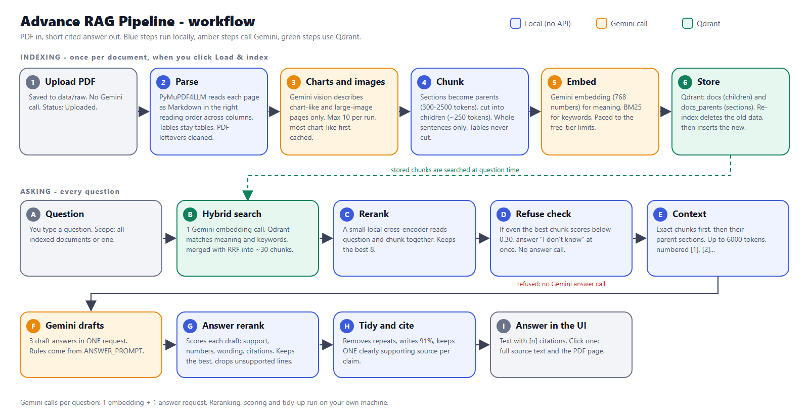
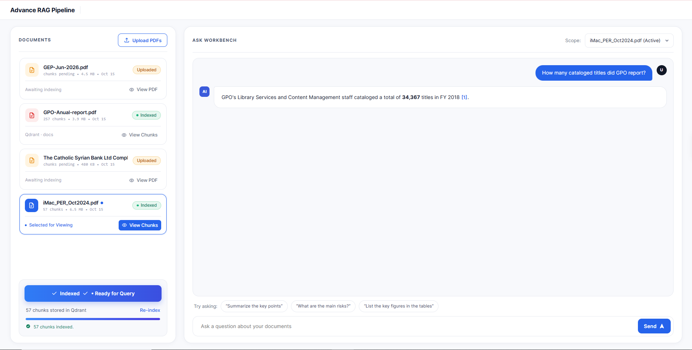
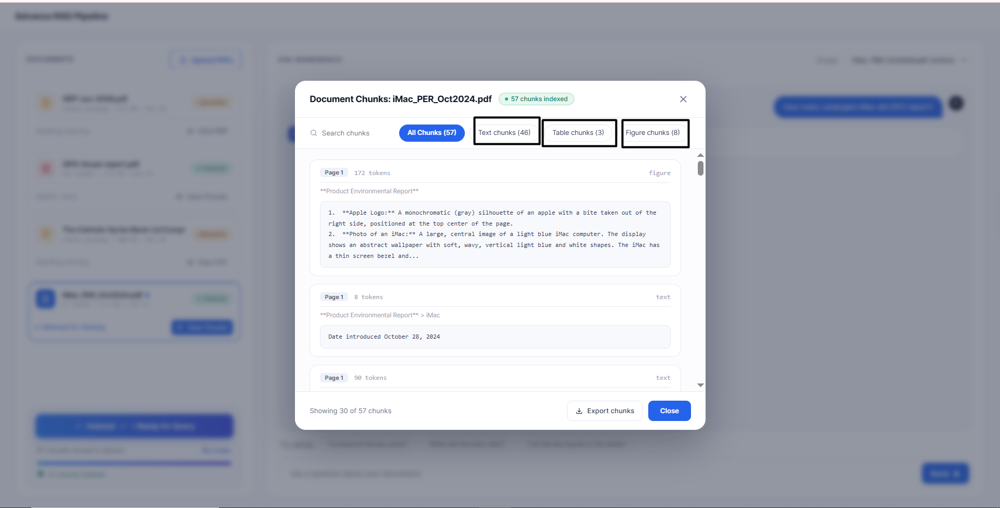
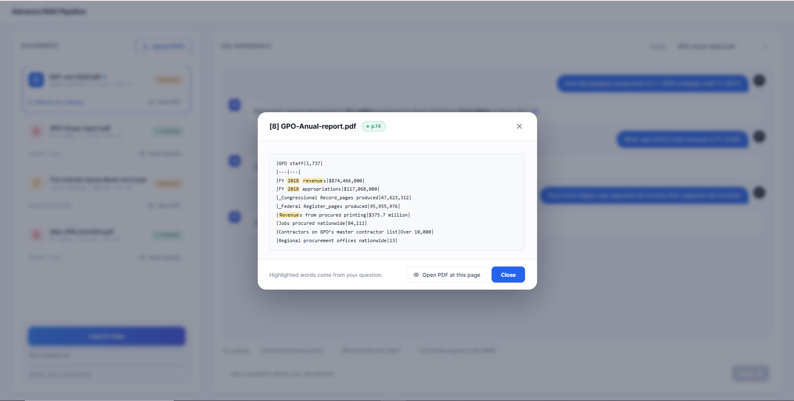
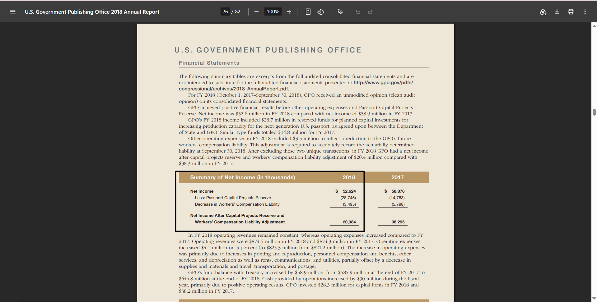

# Advance RAG Pipeline

Ask questions about your PDFs and get short, cited answers. Built with **Qdrant** (vector database) and **Gemini** (embeddings, chart reading, answers). Designed for documents with multiple columns, tables, charts and images.



*Blue steps run on your machine, amber steps call Gemini, green steps use Qdrant. Vector version: [`docs/images/workflow.svg`](docs/images/workflow.svg).*

**What makes it different from a basic RAG:**

- Reads PDFs in the right order across columns and keeps tables as tables.
- Chunks never cut a sentence in half.
- Searches small chunks, then answers from the exact chunks plus the bigger section around them (parent-child).
- Combines meaning search and keyword search, then re-ranks with a local model.
- Writes 3 draft answers and keeps the best-supported one; says "I don't know" when the documents don't contain the answer.
- Every claim carries a `[n]` citation. Click it to read the source text and open the PDF at that page.
- Runs on free tools: Gemini free tier, a local or free-cloud Qdrant, and a small local reranker.

---

## Screenshots

**Ask Workbench:** documents with their state on the left, questions and cited answers on the right.



**Chunk viewer:** every stored chunk of a document, with filters for text, table and figure chunks.



**Click a citation** (`[8]`) to read the exact source text with your question's words highlighted.



**Open PDF at this page** jumps to the page the answer came from, so you can verify it.



---

## How it works

The numbers and letters below match the workflow diagram.

### Indexing (click **Load & index**; once per document)

**1. Upload** (`api.py`)
- The PDF is saved to `data/raw`. No Gemini call. The document shows an amber **Uploaded** tag.

**2. Parse** (`ingestion.py`, `textclean.py`)
- PyMuPDF4LLM reads each page and returns Markdown in the correct reading order, even for multi-column pages. Tables come out as Markdown tables, headings as `#` lines.
- Leftovers such as `<br>`, `<sup>14</sup>` footnote tags and "picture text" markers are removed.

**3. Charts and images** (`ingestion.py`, `gemini.py`)
- Only pages that look like charts (many vector drawings), have a large image, or are scanned are sent to Gemini vision. Plain text pages never are.
- Gemini describes the chart (title, axes, key values, trends) and transcribes text inside images. Each description becomes a `figure` chunk linked to the section it sits in.
- Free-tier protection: at most `max_vision_pages_per_run` (10) pages per run, most chart-like first; results are cached in `data/processed/vision_cache.json` so a page is never described twice; if the daily quota is hit, indexing continues without the remaining charts.

**4. Chunk** (`chunking/`)
- **Section structure:** taken from the PDF outline (table of contents) when it has one, otherwise from the Markdown headings. Page number, heading path and file name are kept on every chunk.
- **Parent sections:** each section becomes a *parent* (about 300-2500 tokens). Tiny sections are merged into the next one; huge ones are split at paragraph and sentence boundaries. Documents with no headings still get parents, so every chunk has one.
- **Child chunks:** each parent is cut into *children* of about 250 tokens (200 for number-heavy text) with one sentence (about 50 tokens) of overlap. These small chunks are what the search matches.
- **Golden rule:** a chunk never ends in the middle of a sentence. Chunks are packed from whole sentences (abbreviations like `Dr.` `e.g.` `Fig. 3` and decimals like `3.5%` are handled), and an over-long sentence stays whole in its own chunk. A sentence that continues across a page break is joined.
- **Tables stay tables:** a table is never cut mid-row. A big table is split by rows with its header repeated. The line that labels a table ("Table 3", "The 24-inch configuration:") is kept with it, and tables in the same section share one parent, so they can be compared.
- **Context header:** every chunk is embedded as `<document> > <section> (p. N)` + text, so the search knows where it comes from.

**5. Embed** (`store.py`, `gemini.py`)
- Gemini `gemini-embedding-001` turns each chunk into a 768-number vector (meaning search). Qdrant builds a BM25 vector from the same text (keyword search).
- Calls are paced to the free-tier per-minute limits (see `rate_limits`).

**6. Store** (`store.py`)
- Two Qdrant collections: `docs` (children, searched) and `docs_parents` (section text, looked up by id).
- **Re-indexing replaces the old data:** the new version is read first; then everything stored for that document (chunks and parents) is deleted and the new chunks are inserted. Other documents are untouched. If storing fails, partial data is removed, so a half-indexed document never shows as "Indexed".

### Asking (every question)

**A. Question** - you type it; the **Scope** box limits the search to one document or all indexed ones.

**B. Hybrid search** (`store.py`)
- One Gemini call embeds your question. Qdrant runs a meaning search and a keyword search (30 candidates each) and merges them with Reciprocal Rank Fusion (RRF). Keywords catch exact numbers and names; embeddings catch paraphrases.

**C. Rerank** (`reranker.py`)
- A small local cross-encoder (`Xenova/ms-marco-MiniLM-L-12-v2`, about 120 MB, runs on ONNX) reads the question and each chunk together and re-orders them. The best 8 are kept.

**D. Refuse check**
- If even the best chunk scores below `min_rerank_score` (0.30), the app answers "I don't know based on the provided records." immediately, without asking Gemini.

**E. Context** (`pipeline.py`)
- The 8 exact chunks come first (they keep precise table values), then their parent sections while there is room, up to `max_context_tokens` (6000). Entries are numbered `[1]`, `[2]`... and keep their file, section and pages.

**F. Gemini drafts** (`pipeline.py`, `gemini.py`)
- The prompt (`ANSWER_PROMPT`) holds the numbered context and the question, plus the writing rules: answer first, say each fact once, use symbols (`91.1%`, `$5`, `100V`), cite as `[n]` before the full stop, one best source per claim, say what is missing, or reply "I don't know...".
- Gemini writes 3 drafts in a single request (one unit of quota).

**G. Answer rerank** (`answer_rerank.py`)
- Each draft is split into lines and scored against the context it cites, using the same local model:

| Check | Weight | Meaning |
|---|---|---|
| support | 0.35 | average and weakest line's match with the evidence |
| number grounding | 0.15 | share of numbers that appear in the context |
| term grounding | 0.20 | share of the answer's words that appear in the context |
| relevance | 0.15 | how well the answer fits the question |
| citation check | 0.15 | cited entries really support the cited lines |

- The best draft wins and unsupported lines are removed. If every draft is "I don't know", the best one is weak (`min_answer_support` 0.25), or it has mostly invented numbers and wording, the app refuses.
- This is a relevance model, not a fact checker: it catches answers that drift from the evidence, not every wrong answer.

**H. Tidy and cite** (`textclean.py`, `answer_rerank.py`)
- Repeated sentences are removed (even when glued together), "91.1 percent" becomes `91.1%`, and sentences stuck together after a citation are separated.
- **One source per claim:** when a group of citations like `[1], [2], [3]` follows a claim, each cited entry is scored against that claim. If one clearly backs it, only that one stays; if none is clear, all stay.

**I. Answer in the UI** (`ui/index.html`)
- Bold text, bullets, tables and `[n]` citations are rendered. Hover a citation to see its file, section and pages; click it to read the source text and open the PDF at that page. **View Chunks → Active in prompt** shows the chunks used for the last answer with their scores.

---

## Quick start

```
pip install -r requirements.txt
copy .env.example .env          # then fill in the keys below
cd "<path>\Advance RAG Pipeline"
uvicorn rag.api:app --app-dir src --port 8000
```

Open http://localhost:8000. Run the command **from the project folder**, otherwise `--app-dir src` cannot find the code.

`.env`:

| Key | Needed | Meaning |
|---|---|---|
| `GEMINI_API_KEY` | yes | from Google AI Studio |
| `QDRANT_URL`, `QDRANT_API_KEY` | no | Qdrant Cloud cluster. If empty, Qdrant runs locally in `data/processed/qdrant`. |

### Using the web UI
1. **Upload PDFs** → the file appears with an amber **Uploaded** tag and is selected.
2. **Load & index** → watch the progress bar (reading pages, describing charts, loading chunks). The tag turns green **Indexed**. One document is processed at a time.
3. Ask questions in the **Ask Workbench**. Pick the document in **Scope**.
4. Click a `[n]` citation to read its source and open the PDF at that page.
5. **View Chunks** opens the chunk viewer: search, filter by type (text / table / figure), export as JSON.
6. **Re-index** replaces a document's old index with a new one.

The page is drawn at 75% so it fits one screen without scrolling (`--ui-zoom` in the page's CSS).

### Command line
```
python scripts/cli.py index                                   # index every PDF in data/raw
python scripts/cli.py ask "your question" [--source file.pdf]
python scripts/cli.py eval eval/questions.jsonl [--no-answer] [--out report.json]
```

### API
| Endpoint | Purpose |
|---|---|
| `GET /` | the web UI |
| `GET /files` | uploaded PDFs with state (uploaded / processing / indexed), size, chunk count |
| `POST /upload` | upload PDFs (replacing a file clears its old index) |
| `POST /index/stream?source=file.pdf[&force=true]` | process one document, streams progress events |
| `POST /ask` `{question, source?}` | answer, sources (with full text and page), reranked chunks |
| `GET /chunks?source=&type=&q=&offset=&limit=` | stored chunks of a document |
| `GET /pdf/{name}` | open an uploaded PDF (add `#page=N` to jump to a page) |
| `GET /status`, `GET /health` | state checks |

---

## Configuration (`configs/default.yaml`)

| Setting | Default | Effect |
|---|---|---|
| `parsing.max_vision_pages_per_run` | 10 | chart pages described per run (0 = no limit) |
| `parsing.describe_visuals` | true | set `false` to skip Gemini vision completely |
| `chunking.target_tokens` / `parent_child.child_target_tokens` | 250 | prose chunk size |
| `parent_child.parent_max_tokens` / `parent_min_tokens` | 2500 / 300 | parent section size |
| `retrieval.top_k_candidates` | 30 | candidates per search branch |
| `retrieval.top_k_final` | 8 | chunks kept after reranking |
| `retrieval.max_context_tokens` | 6000 | context sent to Gemini |
| `retrieval.rerank_model` | MiniLM-L-12 | local reranker (`BAAI/bge-reranker-base` is a bigger option) |
| `retrieval.min_rerank_score` | 0.30 | below this the app refuses |
| `generation.model` | gemini-3.5-flash-lite | answer model |
| `generation.vision_model` | gemini-3.5-flash-lite | chart description model |
| `generation.answer_rerank` / `answer_candidates` | true / 3 | best-of-N answers (`false` = one plain answer) |
| `generation.min_answer_support` | 0.25 | best draft below this → refuse |
| `rate_limits.generate_per_minute` | 12 | Gemini generate requests per minute per model (0 = no limit, for a paid key) |
| `rate_limits.embed_texts_per_minute` / `embed_tokens_per_minute` | 90 / 25000 | embedding texts and tokens per minute (0 = no limit) |

Restart the server after editing the file.

## Gemini calls and cost (free tier)

| When | Gemini calls |
|---|---|
| Upload | 0 |
| Index | up to 10 chart descriptions (cached after the first time) + about 1 embedding request per 32 chunks |
| Each question | 1 embedding + 1 answer request (3 drafts in one request) |
| Question refused at the search stage | 1 (the embedding only) |

Free-tier limits differ per model and per project; see your usage at https://ai.dev/rate-limit. On this project `gemini-2.5-flash` allowed 5 generate requests a minute and 20 a day, while `gemini-3.5-flash-lite` allowed 15 a minute and 500 a day; embeddings allowed 100 texts and 30,000 tokens a minute, and 1,000 a day. The app paces its own calls to stay under the per-minute limits (`rate_limits`), so indexing a document is slower on the free tier. If Gemini still answers 429, the app waits as long as Gemini asks and retries. A daily limit stops the run at once, because waiting does not help.

On the paid tier `gemini-2.5-flash` costs about $0.30 / $2.50 per 1M input / output tokens (Google's pricing page); a question is roughly a cent or less (estimate).

## Project layout

```
configs/default.yaml        all settings
src/rag/
  config.py                 loads the settings
  ingestion.py              PDF -> Markdown -> chunks, chart descriptions, vision cache
  chunking/                 sentences.py (sentence splitter), dynamic.py (chunker),
                            parent_child.py (sections, parents, children)
  textclean.py              cleanup of PDF text and of answers (tidy_answer)
  gemini.py                 Gemini client: embeddings, text, vision, N drafts, rate limits, quota handling
  store.py                  Qdrant: collections, hybrid search, parents, per-document delete
  reranker.py               local cross-encoder
  answer_rerank.py          scoring drafts, choosing the best, one citation per claim
  pipeline.py               ties everything together (read its top comment first)
  api.py, ui/index.html     FastAPI service and the web page
  evaluate.py               retrieval and answer evaluation
  logging_setup.py          writes logs/rag.log
scripts/cli.py              command-line entry point
tests/                      62 automated tests
eval/questions.example.jsonl  template for your own evaluation questions
docs/PIPELINE_PLAN.md       the original design plan
docs/images/                workflow diagram and UI screenshots used in this README
```

## Logs, tests and evaluation

- **Logs:** `logs/rag.log` (rotating text file) records parsing, chunk counts, quota hits, Gemini retries and rate-limit waits, every question with its best rerank score, and the scores of each draft answer.
- **Tests:** `python -m pytest -q tests` (they use fake models and an in-memory Qdrant; no keys or downloads needed).
- **Evaluation:** copy `eval/questions.example.jsonl`, replace the `TODO` entries with real questions (expected pages and keywords), then run `cli.py eval`. It reports hit-rate@k, MRR, correct refusals and false refusals. Use it to tune `min_rerank_score` and `min_answer_support`; the current thresholds are starting values.

## Known limits

- The layout model that reads PDFs needs memory. On a machine with under about 1 GB free it can fail with "bad allocation"; close other apps and retry. Reading a 200-page PDF takes about 2 minutes.
- The reranker is small and English-focused; non-English documents may rank worse.
- Answer scoring is a relevance proxy and can pass a plausible but wrong answer if every draft is wrong.
- Chart descriptions are limited by the free-tier quota; unprocessed chart pages have only their surrounding text.
- A cited parent section can span several pages, so its citation shows a page range; exact chunks show one page.
- The order of chunks within one page is not stored.
- Scanned (image-only) PDFs rely on Gemini vision, which is quota-limited.

## Troubleshooting

| Problem | Fix |
|---|---|
| `No module named 'rag'` | run `uvicorn` from the project folder |
| `GEMINI_API_KEY is not set` | keys go in `.env`, not `.env.example` |
| 429 `RESOURCE_EXHAUSTED` (per day) | the free quota is used up; wait, or change `generation.model` |
| 429 per minute (chart descriptions or embeddings) | the app paces itself (`rate_limits`) and waits as Gemini asks; indexing a big document is slow on the free tier. On a paid key set the limits to 0. |
| "Nothing is indexed yet" | click **Load & index** and wait for the green **Indexed** tag |
| Clicking a citation does nothing | restart the server and hard-refresh (Ctrl+F5); older pages used a different click action |
| A floating panel or icon on the right | a browser extension, not this app; disable it for `localhost` |
