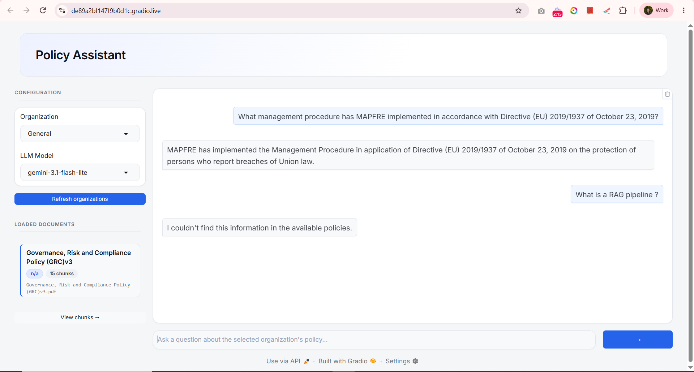
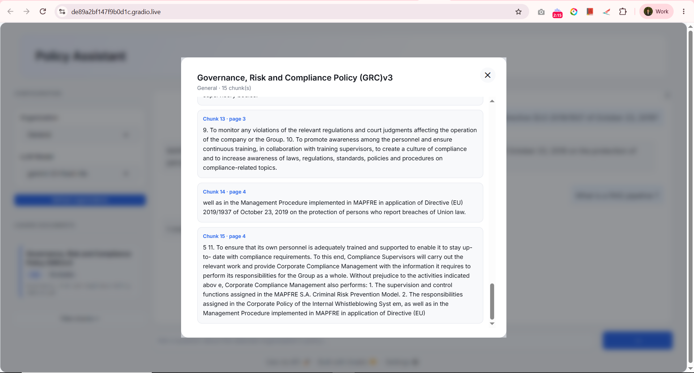

# Policy RAG Chatbot

A multi-organization policy assistant that answers questions **strictly** from indexed policy PDFs — grounded, cited implicitly by source, and honest when the answer isn't in the documents. Built as a notebook-first RAG project: Google Gemini for embeddings/generation, Qdrant Cloud as the persistent vector store, and a Gradio console UI.

**Live Kaggle notebook:** [kaggle.com/code/utsavkatharotiya0712/policy-assistant-rag-chatbot](https://www.kaggle.com/code/utsavkatharotiya0712/policy-assistant-rag-chatbot)

## Screenshots

**Policy Q&A console** — organization/model selection, loaded documents sidebar, chat:



**Chunk viewer modal** — click any loaded document to see its actual stored chunks (the vector-store content that grounds answers):



## Pipeline

```
PDF Upload
    ↓
Page-Aware Text Extraction
    ↓
Organization / Policy Tagging
    ↓
Text Chunking
    ↓
Embeddings (Gemini)
    ↓
Qdrant Cloud (Persistent Vector Store)
    ↓
Organization-Filtered Retrieval
    ↓
Strict LLM Prompt
    ↓
Answer
    ↓
Fallback:
"I couldn't find this information in the provided documents."
```

1. **PDF Upload** — via `ipywidgets.FileUpload` in Section 1.6, one batch of PDFs at a time.
2. **Page-aware Text Extraction** — `PyPDFLoader` reads each PDF page-by-page, so citations/chunks retain their source page number.
3. **Organization/Policy Tagging** — the filename is parsed into `organization`, `policy_name`, `policy_version` (or falls back to a generic `"General"` organization if the filename doesn't follow the convention).
4. **Chunking** — `RecursiveCharacterTextSplitter` splits each page into overlapping chunks, carrying the tagged metadata forward.
5. **Embeddings** — each chunk is embedded with Gemini's `gemini-embedding-001`.
6. **Qdrant Cloud** — chunks + metadata are stored in a single shared collection; re-uploading the same `(organization, policy_name)` replaces the old version.
7. **Organization-filtered Retrieval** — at query time, similarity search is scoped to the selected organization's chunks only, so one company's policies can never answer another's questions.
8. **Strict LLM Prompt** — the retrieved chunks are passed to Gemini with instructions to answer only from that context.
9. **Answer** — returned as-is, or the required fallback message if nothing relevant was retrieved.

## What it does

- Ingests policy PDFs, one organization/policy pair at a time, via a simple upload widget (`ipywidgets.FileUpload` — works the same in Kaggle, Colab, or plain Jupyter).
- Auto-parses organization, policy name, and version straight from filenames like `01_technova_Leave_Time_Off_Policy_v1_0.pdf`.
- Chunks and embeds each PDF (Gemini embeddings) into a shared **Qdrant Cloud** collection, tagged with `organization` / `policy_name` / `policy_version` / `source_file` / `page` metadata.
- Retrieval is **filtered by organization** at query time — one company's policies can never leak into another's answer.
- Re-uploading a PDF for the same `(organization, policy_name)` replaces the old version; different policies for the same org (Leave, WFH, Travel, ...) all coexist.
- Answers come from a strict prompt: only the retrieved context is used, and unsupported questions get exactly *"I couldn't find this information in the available policies."*
- A Gradio UI lets you pick an LLM model, upload and index a PDF, chat with it, and inspect exactly which chunks are stored for any loaded document (via a modal, no page navigation needed). The UI has its own upload control, so you don't have to use Section 1.6 at all if you'd rather upload and ask in the same place.
- The UI is a single-screen layout: header, Configuration / Upload Document / Loaded Documents cards on the left (Loaded Documents is a collapsible section, closed by default, with its own scrollbar), and a chat panel on the right with a context bar, suggested-prompt pills and a pill-shaped input. Only the chat transcript scrolls; the rest of the page stays fixed to the viewport. Answers show the retrieved chunks (rank, page, score) beneath them.
- Every tunable — model, temperature, chunk size/overlap, top-k, similarity threshold, strict mode — is driven by an environment variable with a sensible default (see **Configuration** below).

## Configuration

Set any of these as environment variables before running the Setup cells to override the defaults:

| Variable | Purpose | Default |
|---|---|---|
| `GEMINI_API_KEY` | Your Gemini API key (required) | *(none — required)* |
| `GEMINI_MODEL` | Default Gemini model for answers | `gemini-3.5-flash-lite` |
| `GEMINI_TEMPERATURE` | Sampling temperature (0.0–2.0); lower = more literal/consistent | `0.2` |
| `EMBEDDING_MODEL` | Gemini embedding model name | *(blank = auto-detect)* |
| `QDRANT_COLLECTION_NAME` | Qdrant Cloud collection name | `policy_documents` |
| `CHUNK_SIZE` | Characters per chunk | `800` |
| `CHUNK_OVERLAP` | Character overlap between chunks | `150` |
| `TOP_K` | Number of chunks retrieved per question | `5` |
| `SIMILARITY_THRESHOLD` | Minimum cosine similarity ([-1, 1]) for a chunk to count as relevant | `0.2` |
| `STRICT_DOCUMENT_MODE` | Refuse to answer beyond the documents (`true`/`false`) | `true` |

## Stack

Python · LangChain · Google Gemini (`gemini-embedding-001` for embeddings, Gemini chat models for generation) · Qdrant Cloud (free tier) · Gradio

## Project files

| File | Purpose |
|---|---|
| `RAG_Based_ChatBot.ipynb` | The project notebook — pipeline (PDF → chunks → Qdrant → retrieval → strict RAG) + Gradio UI. |
| `LLM_Fundamentals_Basics.ipynb` | Companion notebook covering the underlying LLM/RAG concepts (frameworks, memory, embeddings, RAG basics) this project builds on. |
| `policy_assistant.css` | Optional legacy styling for the Gradio UI. The current layout, cards, chat and modal CSS are all embedded in the notebook, so this file is not needed. |
| `Sample Documents/` | 15 sample policy PDFs across 3 fictional organizations (`technova`, `databridge`, `git`) for testing multi-org isolation and version replacement. |

## Running it

1. Open `RAG_Based_ChatBot.ipynb` in Kaggle, Colab, or Jupyter.
2. **Setup**: run the install cell, then provide a **Gemini API key** ([Google AI Studio](https://aistudio.google.com/app/apikey)) and **Qdrant Cloud** credentials (free cluster at [cloud.qdrant.io](https://cloud.qdrant.io) — cluster URL + API key).
3. Run **Section 1** (1.1–1.5) to build the pipeline.
4. Run **Section 1.6** to batch-upload and index your policy PDFs (e.g. everything in `Sample Documents/`) — or skip this and upload one at a time from the Gradio UI in the next step.
5. Run **Section 2** to launch the Gradio console — upload a PDF there if you skipped step 4, pick a model, select a loaded document, then ask questions.

The Gradio UI's styling is embedded in the notebook (one `<style>` block), so no extra files are needed. It is built for current Gradio 5/6; `policy_assistant.css` is an optional leftover and isn't required.

## Scope (V1)

- PDF policies only — one active version per `(organization, policy_name)`.
- Organization and policy metadata are entered manually at upload time (via filename parsing), not auto-detected from document content.
- No conversation history / multi-turn memory — each question is answered independently.
